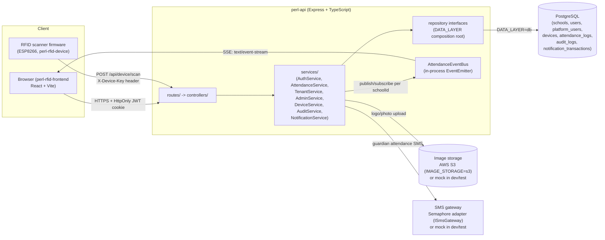

# PERL Architecture

This document describes the current, implemented architecture of the rebuilt PERL platform — not the roadmap (see `CLAUDE.md` for phase history and `PLAN.md` for status). It is grounded in the actual code under `perl-api/src/` and `perl-rfid-frontend/src/` as of the PostgreSQL persistence migration (see `planning/CHANGELOG.md`).

## 1. Ports & Adapters Layering

The API follows a strict one-directional dependency chain:

```
routes/  →  controllers/  →  services/  →  repositories/interfaces/  →  repositories/mock/ | repositories/db/
```

- **Routes** (`perl-api/src/routes/*.ts`) wire Express paths to a controller and attach the auth/rate-limit middleware chain. There are five route groups: `authRoutes`, `attendanceRoutes`, `adminRoutes`, `schoolRoutes`, `supportRoutes` (plus `healthRoutes`), all mounted under `/api` in `perl-api/src/app.ts`.
- **Controllers** (`perl-api/src/controllers/*.ts`) parse/validate HTTP input, call one or more services, and shape the HTTP response. They hold no business rules — e.g. `attendanceController.ts` resolves the request's authorized school, delegates the actual admit/deny decision entirely to `AttendanceService`.
- **Services** (`perl-api/src/services/*.ts`) hold business logic and depend only on repository *interfaces*, never on a concrete mock or database class:
  - `AuthService` — login, session shaping, self-service profile updates, role/schoolId access checks
  - `AttendanceService` — the admit/deny state machine, cooldown/daily-cap rules, log listing/export
  - `TenantService` — school (`SchoolProfile`) resolution, creation, and profile updates
  - `AdminService` — school-scoped user CRUD, CSV import, device/user administration surface
  - `DeviceService` — device registration, one-time key issuance, key rotation/revocation, key authentication
  - `AuditService` — writes/reads the `audit_logs` action trail
  - `NotificationService` — turns admitted student scans into guardian SMS delivery attempts
  - `SchoolDataService` — school-scoped export/backup/restore and erasure operations (Phase 8 compliance)
  - `ImageService` — validates and stores uploaded logo/user photos through `IImageStorage`
- **Repository interfaces** (`perl-api/src/repositories/interfaces/`) are narrow, feature-specific ports: `ITenantRepository`, `IUserRepository`, `IPlatformUserRepository`, `IAttendanceRepository`, `IDeviceRepository`, `IAuditRepository`, `INotificationRepository`. Services never see more than the interface they need.
- **Adapters**: `repositories/mock/*` (in-memory, seeded, used for local dev and the default test suite) and `repositories/db/*` (PostgreSQL via the `pg` driver — no ORM) each implement the exact same interfaces.

### The `DATA_LAYER` composition root

`perl-api/src/repositories/index.ts` is the single place that switches on `DATA_LAYER`:

```ts
export const createRepositories = (dataLayer: DataLayer = env.dataLayer): RepositorySet => {
  if (dataLayer === 'mock') return createMockRepositories();
  return createDbRepositories();
};
```

- `env.dataLayer` (`perl-api/src/config/env.ts`) resolves `DATA_LAYER=mock|db` from the environment, defaulting to `mock`.
- `initializeRepositoryLayer()` only runs `initializeDatabase()` (schema creation + seed-if-empty, `perl-api/src/repositories/db/schema.ts`) when `dataLayer === 'db'`; mock mode needs no bootstrap.
- `resetRepositoriesForTests(dataLayer)` gives both layers an identical reset/reseed hook so the same behavioral test suite (`perl-api/tests/`) can run against either backend via `TEST_DATA_LAYERS`.
- No code outside this file branches on `DATA_LAYER` — controllers and services are handed a `RepositorySet` and never know which adapter backs it. This is what makes the mock-to-Postgres swap a config change, not a rewrite.

When `DATA_LAYER=db`, connections are pooled once via `perl-api/src/repositories/db/pool.ts` (`pg.Pool`, max 10 connections, SSL optional per `DB_SSL`).

## 2. Tenant / School Branding Model

Every school is a `SchoolProfile` (`perl-api/src/types/SchoolProfile.ts`), owned by `ITenantRepository`/`TenantService`:

- Identity: `id`, `slug`, `name`, `contactEmail`
- Branding: `logoUrl`, `theme.{primaryColor,secondaryColor,accentColor}` (hex, validated in `TenantService.createSchool`)
- Institution details (added post-launch): `address`, `phone`, `timezone` (default `Asia/Manila`), `academicYearLabel`, `depedSchoolId`
- SMS settings: `smsEnabled`, `smsSenderName`

Resolution never happens client-side: the backend derives `schoolId` from the verified session (JWT), fetches the `SchoolProfile` server-side, and the frontend `ThemeProvider` (`perl-rfid-frontend/src/providers/ThemeProvider.tsx`) applies `theme.*` as CSS custom properties (`--school-primary`, `--school-secondary`, `--school-accent`) before the authenticated shell renders — there is no public school selector or client list.

## 3. Role Model

Two independent role universes, both carried in the signed JWT:

**School-scoped roles** (`schoolId` is non-null, enforced server-side on every request):

| Role | Scope |
|---|---|
| `ADMIN` | Full management of their own school (profile, users, devices, exports) |
| `STAFF` | Non-student card holder; can view the live monitor and school attendance |
| `STUDENT` | RFID card holder; sees only their own attendance |
| `GUARDIAN` | Notification recipient; sees only their linked student(s)' attendance |

**Platform-scoped roles** (`schoolId: null`, must select an explicit, audited target school for any cross-school action — `perl-api/src/routes/supportRoutes.ts`, `perl-api/src/auth/permissions.ts`):

| Role | Scope |
|---|---|
| `SYSTEM_ADMIN` | Provisions new schools, administers any selected school |
| `SUPPORT` | Read-only cross-school inspection, global audit log, monitor diagnostics |

`perl-api/src/auth/permissions.ts` centralizes the role sets used by route guards (`schoolReadRoles`, `schoolManagementRoles`, `liveMonitorRoles`, `monitorDiagnosticRoles`, `isPlatformRole`), so authorization rules live in one file rather than being re-derived per route.

## 4. Deployment Topology



Runtime pieces:

- **`perl-rfid-frontend`** — React + Vite SPA, served by Vite dev server locally or bundled into the single root Docker image.
- **`perl-api`** — Express + TypeScript API, stateless aside from the in-process `AttendanceEventBus` and rate-limit counters (both per-process, acceptable for a single-instance deployment — see `SYSTEM-DESIGN.md` for why this is not yet Redis-backed).
- **PostgreSQL** — the real persistence engine for `DATA_LAYER=db` (`postgres:16-alpine` in `docker-compose.yml`), accessed directly through the `pg` driver with no ORM.
- **S3 (or mock)** — school logos and user photos, behind `IImageStorage` (`perl-api/src/storage/`); `AwsS3ImageStorage` for `IMAGE_STORAGE=s3`, `MockImageStorage` otherwise.
- **SMS gateway (Semaphore, or mock)** — guardian attendance notifications, behind `ISmsGateway` (`perl-api/src/notifications/`); `SemaphoreSmsGateway` for `SMS_PROVIDER=semaphore`, `MockSmsGateway` otherwise.
- **RFID device firmware** — talks to the API over plain HTTP(S), authenticating with a per-device key sent in the `X-Device-Key` header (never a URL query string), scoped to one school via `DeviceService`.

Both API and frontend run together from one container built off the root `Dockerfile`, orchestrated by `docker-compose.yml` (`perl-app` + `postgres` services); `scripts/docker-start.sh` starts both dev servers in that container and, when `DATA_LAYER=db`, waits for Postgres via `scripts/wait-for-postgres.sh` before booting.
