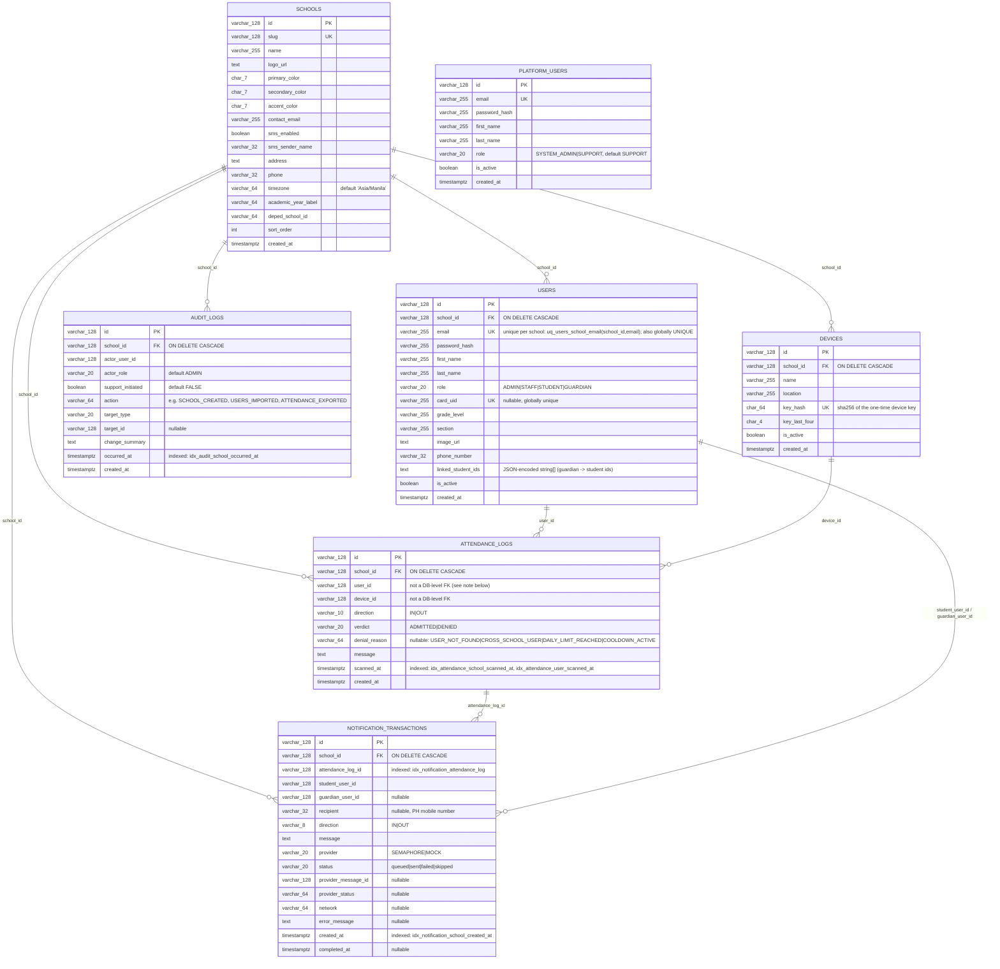

# PERL Data Model

This documents the real PostgreSQL schema used when `DATA_LAYER=db`, as defined in `perl-api/src/repositories/db/schema.ts` (the single source of truth — tables are created there with `CREATE TABLE IF NOT EXISTS`, and existing databases are migrated forward idempotently via `ensureColumn`). The mock repositories (`perl-api/src/repositories/mock/`) implement the exact same `IUserRepository`/`ITenantRepository`/etc. interfaces and return objects shaped identically to the mapped Postgres rows (see `perl-api/src/repositories/db/mappers.ts`) — there are no mock-only convenience fields that diverge from the real schema.

## Entity-Relationship Diagram

## Key Constraints

- **Tenant isolation via foreign key, not application convention alone.** `users`, `devices`, `attendance_logs`, `audit_logs`, and `notification_transactions` all carry `school_id VARCHAR(128) NOT NULL REFERENCES schools(id) ON DELETE CASCADE`. Deleting a school cascades to every row that belongs to it, so there is no dangling cross-tenant data at the database level — this is a hard backstop underneath the service-layer `schoolId` scoping described in `ARCHITECTURE.md` and `SYSTEM-DESIGN.md`.
- **Uniqueness**: `schools.slug` is globally unique (subdomain-safe tenant identifier); `users.email` is globally unique *and* additionally constrained by `uq_users_school_email UNIQUE (school_id, email)` (the global uniqueness is what lets the public login form resolve a user without asking which school first — see the auth flow in `SYSTEM-DESIGN.md`); `users.card_uid` is globally unique so a scanned RFID card UID resolves to exactly one person; `devices.key_hash` is globally unique (the sha256 of a device's one-time key); `platform_users.email` is globally unique.
- **Indexes**: `idx_attendance_school_scanned_at (school_id, scanned_at DESC)` and `idx_attendance_user_scanned_at (user_id, scanned_at DESC)` back the paginated attendance-log and per-user attendance queries; `idx_audit_school_occurred_at (school_id, occurred_at DESC)` backs the paginated audit log; `idx_notification_school_created_at (school_id, created_at DESC)` and `idx_notification_attendance_log (attendance_log_id)` back the SMS delivery-history screen and looking up notifications for a given scan.
- **`attendance_logs.user_id` and `.device_id` are intentionally not database-level foreign keys.** A denied scan (unrecognized card) is recorded with a sentinel `user_id = 'unknown-user'` (`AttendanceService.createDeniedLog`) so every scan attempt — including ones that never resolved to a real person — is auditable; a hard FK to `users.id` would reject that row. Referential integrity for known users/devices is enforced in the service layer instead (`AttendanceService.scanCard` looks up and validates both before writing).
- **`users.linked_student_ids`** is a `TEXT` column holding a JSON-encoded array of student user IDs (guardian → student links), not a join table. `mapUserRow` parses it defensively (invalid/missing JSON falls back to `[]`) rather than failing the read.
- **Schema evolution is additive and idempotent**: new columns (`address`, `phone`, `timezone`, `academic_year_label`, `deped_school_id` on `schools`; `phone_number`, `linked_student_ids` on `users`; `actor_role`, `support_initiated`, `change_summary` on `audit_logs`) are added via `ensureColumn()`, which checks `information_schema.columns` before running `ALTER TABLE ... ADD COLUMN`, so re-running schema initialization against an existing database is always safe.
- **Database bootstrap is concurrency-safe.** `initializeDatabase()` takes a Postgres advisory lock (`pg_advisory_lock`/`pg_advisory_unlock`, fixed key) around table creation and seed-on-empty so multiple API processes booting against the same empty database don't race to seed duplicate rows.

## ID Scheme

Every primary key is a `VARCHAR(128)` string, never a numeric auto-increment column. IDs are generated per-entity in the service layer, not the database:

- Schools: `school-${randomUUID()}` (`TenantService.createSchool`) — seeded schools instead use readable slugs like `school-st-marys`.
- Users: `user-${schoolId}-${Date.now()}` (`AdminService.createUser`).
- Devices: `device-${schoolId}-${Date.now()}` (`DeviceService`).
- Audit records: `audit-${randomUUID()}` (`AuditService`).

This was a deliberate choice, consistent with how the mock repositories already worked before Postgres existed: IDs are assigned by application code so the exact same ID a mock-mode test or seed generates is what a real-mode run would generate too, keeping `IUserRepository`/`ITenantRepository`/etc. fully interchangeable between adapters (Liskov substitution — see `CLAUDE.md` Section 2). A numeric auto-increment primary key would force IDs to be assigned by whichever database is currently wired in, breaking that interchangeability and leaking a database-specific detail (sequence values) into code and tests that are supposed to be storage-agnostic. String IDs also avoid ID collisions across the mock/db swap in tests that seed both layers with the same fixtures.
