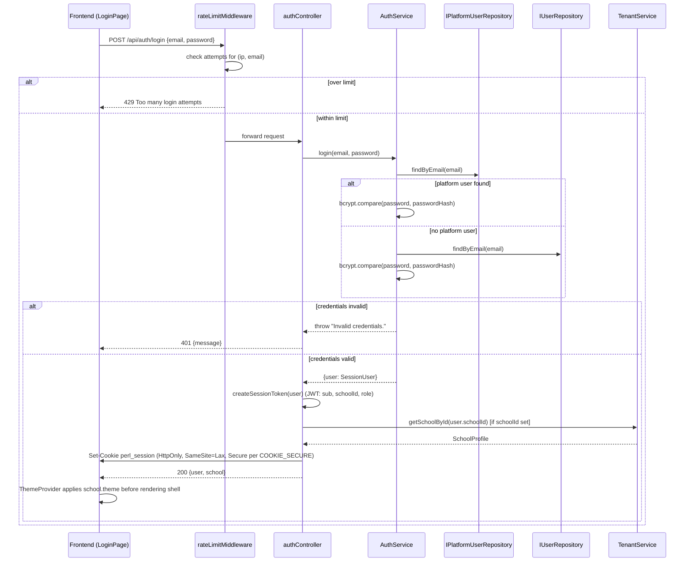
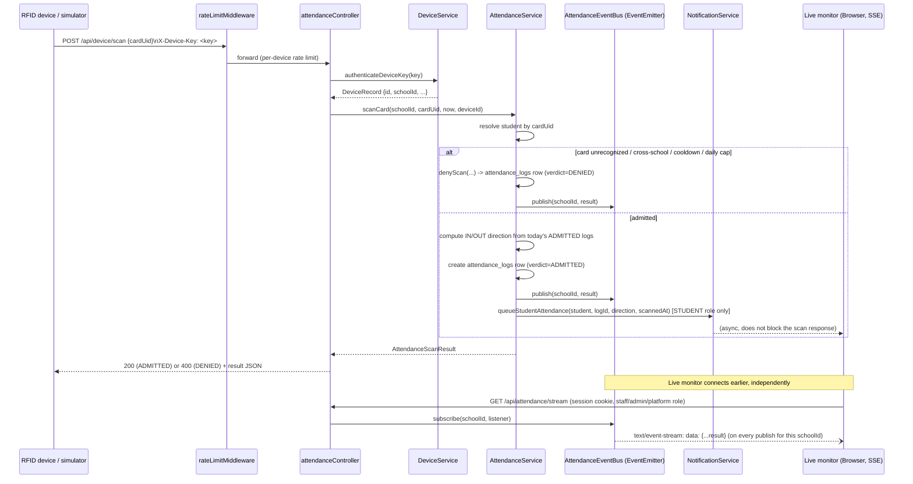
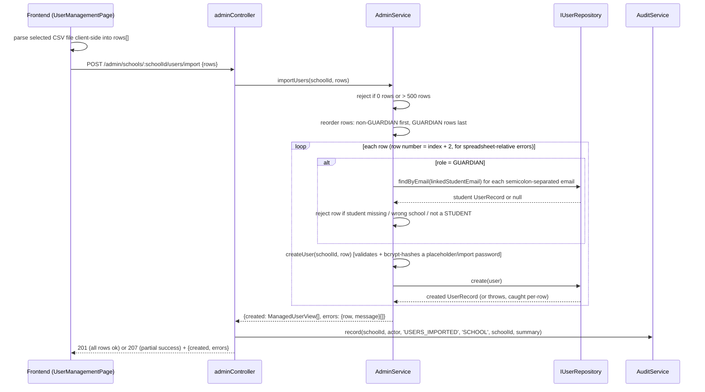
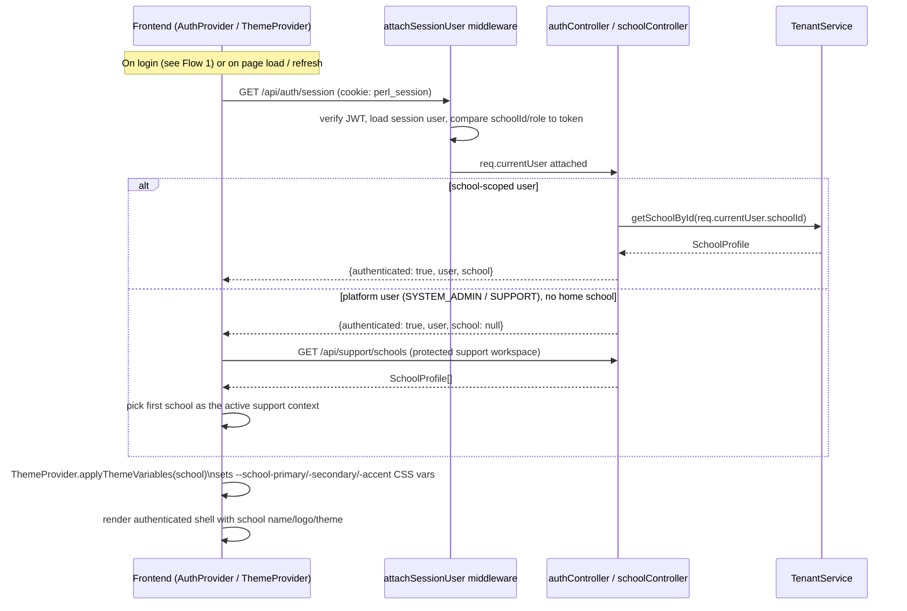

# PERL System Design

Flows below are traced from the actual route/controller/service code, not from intent. File references point at the real implementation so another agent can verify or extend a flow without re-deriving it.

## 1. Auth Login

`POST /api/auth/login` (`perl-api/src/routes/authRoutes.ts` → `authController.login`, `perl-api/src/controllers/authController.ts`) is rate-limited per `(client IP, email)` pair (`createRateLimiter` + `resolveLoginRateLimitKey`, default 5 attempts / 60s). `AuthService.login` checks the platform-user table first, then the school-scoped user table, so one login form serves both without asking which school first — this is why `users.email` is globally unique (see `DATA-MODEL.md`).



Notes: passwords are bcrypt-hashed (cost 10) both at rest and at comparison time — never MD5, never plaintext. The session is a JWT inside an HttpOnly cookie (`perl-api/src/auth/session.ts` + `setSessionCookie`), never `localStorage`. Login and the subsequent branding resolution are a single round trip: the response already includes `school`, so the frontend never needs a second `GET /api/school/current` call to render the branded shell (see [Section 4](#4-school-branding-resolution)).

## 2. RFID Scan → Verdict → Live Monitor (SSE)

`POST /api/device/scan` (`attendanceController.scanCard`) accepts either a device-authenticated request (`X-Device-Key` header, no session) or an authenticated browser simulation restricted to `SUPPORT`/`SYSTEM_ADMIN` (`monitorDiagnosticRoles`). It is rate-limited per device-key hash or per client IP (`resolveDeviceScanRateLimitKey`).



The realtime payload already carries everything the monitor needs to render — display name, verdict, direction, timestamp, device name/location, and the student's photo URL — so the frontend never makes a second fetch to show the result (this was an explicit Phase 3 latency requirement; see `planning/PLAN.md`).

## 3. Admin CSV People Import

`POST /admin/schools/:schoolId/users/import` (`adminController.importUsers` → `AdminService.importUsers`) is restricted to `schoolManagementRoles` (`ADMIN`, `SYSTEM_ADMIN`).



Guardians are always processed after every other role in the same import batch specifically so a guardian row can link to a student created earlier in the same file. Every row's failure is independent and reported with its 1-based spreadsheet row number; a bad row never aborts the rest of the batch. The whole import is one audited action (`USERS_IMPORTED`) rather than one audit entry per created user.

## 4. School Branding Resolution

There is no client-supplied "which school" input anywhere in this flow — the frontend never sends a school identifier for its own account.



`GET /api/school/current` (`schoolController.getCurrentSchool`) is also available and resolves the same way from `req.currentUser.schoolId`, but the current frontend does not call it directly — branding is resolved inline from the `/auth/login` and `/auth/session` response payloads, which already embed `school`. The backend always derives the school from the verified session, never from a client-supplied slug or ID, for an ordinary school user.

## In-Process SSE Event Bus

`AttendanceEventBus` (`perl-api/src/services/AttendanceEventBus.ts`) is a thin wrapper around Node's `EventEmitter`:

```ts
class AttendanceEventBus {
  private readonly emitter = new EventEmitter();
  publish(event: AttendanceScanResult) { this.emitter.emit(event.schoolId, event); }
  subscribe(schoolId: string, listener) { this.emitter.on(schoolId, listener); return () => this.emitter.off(schoolId, listener); }
}
```

- **Emitter**: `AttendanceService.scanCard` (and `denyScan`) publish every scan result — admitted or denied — keyed by `schoolId`.
- **Subscriber**: `attendanceController.streamEvents`, mounted at `GET /api/attendance/stream`, subscribes using the *authenticated* request's own school (never a client-chosen one), writes each event as an SSE `data:` frame, and unsubscribes when the HTTP connection closes (`req.on('close', unsubscribe)`).
- **Per-school scoping**: the emitter uses the `schoolId` string itself as the Node event name, so `emitter.on('school-st-marys', ...)` only ever receives events published with that exact school ID. A listener for one school structurally cannot receive another school's events — there is no filtering step that could be forgotten.

### Why Redis pub/sub is deferred, not missing

`CLAUDE.md` Section 8 lists this explicitly: *"Redis pub/sub for realtime — build when we observe actual multi-tenant concurrent WS load that a single in-process broadcaster can't handle — not before."* This is YAGNI applied to infrastructure, not just code (Section 1/2): a single Node process handling one API instance's SSE connections has no cross-process fan-out problem to solve yet. Introducing Redis now would add an operational dependency (a service to run, monitor, and secure) to solve a scaling problem this deployment does not have — there is currently one API process, so every subscriber for a school is already reachable by the one process handling that school's scans. Redis becomes justified the moment the API runs as more than one process/instance and a scan handled by process A needs to reach a monitor connected to process B.

## Security Baseline (Implemented)

- **Passwords**: bcrypt (cost 10) everywhere credentials are stored or verified — `AuthService.login`, `AuthService.updateProfile`/`assertPasswordChange`, `AdminService.createUser`. Never MD5, never unsalted (`planning/PLAN.md` documents this as a deliberate rejection of the legacy app's MD5 hashing).
- **Sessions**: JWT issued by `createSessionToken` (`perl-api/src/auth/session.ts`), delivered only via an `HttpOnly`, `SameSite=Lax` cookie (`Secure` when `COOKIE_SECURE=true`, mandatory in production per `validateRuntimeEnvironment`). Never stored in `localStorage`. `attachSessionUser` re-verifies the token and re-checks `schoolId`/`role` against the freshly loaded user on every request, so a stale or tampered claim in an old cookie cannot outlive a role/school change.
- **CORS**: explicit allow-list only (`perl-api/src/app.ts`, `env.allowedOrigins`), never a wildcard; production additionally requires every allowed origin to be HTTPS (`validateRuntimeEnvironment`).
- **Rate limiting**: in-process, per-key sliding-window limiter (`createRateLimiter`, `perl-api/src/middleware/rateLimitMiddleware.ts`) applied to `/api/auth/login` (keyed by IP+email) and `/api/device/scan` (keyed by device-key hash, or IP for browser simulation). Same in-process-only tradeoff as the SSE bus above — acceptable for a single API instance, revisit if the API is ever horizontally scaled.
- **Cross-school isolation, enforced server-side**: every authenticated route that touches school-owned data resolves `schoolId` from the verified JWT (`req.currentUser.schoolId`), never from a client-supplied route/query parameter for ordinary school users (`requireRole` even validates that the route's `:schoolId` param matches what the session is authorized for). Platform roles (`SYSTEM_ADMIN`/`SUPPORT`) must go through the separately audited support workspace to act against an explicit target school. The database's `ON DELETE CASCADE` foreign keys back this up structurally (`DATA-MODEL.md`).
- **Device credentials**: sent only via the `X-Device-Key` request header, never a URL query string; stored as a sha256 hash (`devices.key_hash`), never as plaintext.
